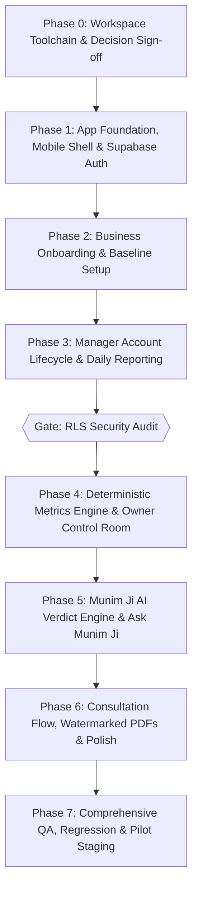

# Munim Ji — Complete Master Implementation Plan (IMPLEMENTATION_PLAN.md)

**Product:** Munim Ji — Your Personal Business Manager  
**Version:** 1.1 | **Date:** 11 October 2026  
**Reference Sources:** 
- `Munim Ji — Complete Build & Handover Guide (1).html`
- `Munim_Ji_Antigravity_Documentation_Pack` (PRD, TRD, Data Dictionary, Playbook, RLS Threat Model, QA Tests, Roadmap, Release Runbook)

---

## 1. Executive Summary & Assessment

### 1.1 Repository State
- **Workspace:** `c:\Users\mi\Munimji`
- **Initial Assets Provided:**
  - `Munim Ji — Complete Build & Handover Guide (1).html`
  - `Munim_Ji_Antigravity_Documentation_Pack/` (all 9 specification & governance documents)
- **Code Status:** Clean Greenfield repository. No legacy code or conflicting technical debt.
- **Local Toolchain Assessment:**
  - `git` version 2.52 is operational.
  - Node.js LTS (v20+) is required on the local Windows workstation to execute local Vite development, unit tests, and production builds.

### 1.2 Core Philosophy & Non-Negotiable Rules
> *"Managers provide the data. Munim Ji understands the data. The owner makes better decisions."*

1. **Deterministic Financial Math:**
   All revenues, expenses, profit estimates, collections, outstanding amounts, recovery percentages, and break-even calculations are executed **strictly in PostgreSQL / deterministic TypeScript**. The LLM (Munim Ji AI) explains metrics and suggests actions; it is **strictly forbidden from calculating financial figures**.
2. **Supabase Row Level Security (RLS) is Non-Negotiable:**
   Data isolation between owners and managers is enforced strictly at the database layer. No frontend filtering can act as a security boundary. Service-role keys and AI keys are strictly barred from the client bundle.
3. **The New vs Existing Business Fork:**
   - **New Business:** Full Day 1 baseline (initial investment, owner capital, setup/equipment, working capital, monthly fixed expenses, expected recovery months, break-even target).
   - **Existing Business:** 5–6 question Business Snapshot (approx age, self-reported profitability, monthly revenue/expense brackets, investment recovered status, key operational bottlenecks). No forced historical backfill.
   - **Metric Suppression:** If an existing business marks initial investment as already recovered, recovery progress is completely retired from its dashboard (never shown as zero or stale).
4. **AI Learning / Calibration Period:**
   For the first ~2–4 weeks (or minimum 7–14 daily reports), Munim Ji displays an honest *"Calibrating your business rhythm"* state instead of hallucinating early verdicts.
5. **No Decorative Dead UI:**
   Every card, button, chart switch, notification item, and alert must navigate or trigger a real, working workflow.
6. **Strict Exclusions from MVP:**
   No POS billing, no barcode scanner, no SKU-level inventory, no GST billing, no voice wake-phrase at launch, no CSV backfill at launch.

---

## 2. Complete Logical Architecture & Data Flow

```text
       Manager Reporting Tool (Mobile/Web)                 Owner Master Control Room
       (Frictionless daily health logs)              (Portfolio, Recovery, Alerts, Trends)
                     │                                                 ▲
                     ▼                                                 │
      ┌────────────────────────────────────────────────────────────────────────┐
      │                                Supabase                                │
      │          PostgreSQL + Auth + Row Level Security + Realtime             │
      │                  (Isolated multi-tenant boundaries)                    │
      └────────────────────────────────────────────────────────────────────────┘
                     │                                                 ▲
                     ▼                                                 │
      Deterministic Metrics Engine (SQL)              Munim Ji AI (Edge Functions)
      (Daily/Monthly aggregates & health)             (Evidence-grounded verdicts)
                     │                                                 │
                     ▼                                                 ▼
      Private Supabase Storage                     External Integrations
      (Watermarked PDFs & Profiles)                (₹499 Consultation / WhatsApp / Email)
```

---

## 3. Phased Implementation Roadmap & Deliverables



---

### Phase 0: Workspace Setup, Toolchain & Decision Sign-Off (Current Phase)
- **Tasks:**
  - Establish complete baseline documentation (`docs/IMPLEMENTATION_PLAN.md`, `docs/DECISIONS.md`, `AGENTS.md`, `.env.example`).
  - User confirms local Node.js LTS setup.
  - Review and approve baseline financial definitions and reporting cutoff times in `docs/DECISIONS.md`.
- **Definition of Done:** Decisions approved; environment ready for clean initialization.

---

### Phase 1: Foundation, Responsive Design System & Supabase Auth
- **Tasks:**
  - Scaffold React + TypeScript + Vite project with Tailwind CSS & custom design tokens.
  - Build Mobile-First Responsive App Shell:
    - Mobile bottom navigation bar: **Home | Businesses | Munim Ji | Alerts | Profile**.
    - Desktop header with business switcher, profile thumbnail, and notification bell.
  - Supabase client initialized using **public anon key only**.
  - Database Migration: `profiles` table with strict RLS (`auth.uid() = id`).
  - Owner authentication: Email/Password login, Sign-up, Password Reset, Session persistence.
  - Profile Management: Full name, phone, language preference, and **in-browser profile photo crop & upload** to private Supabase Storage bucket.
  - Internationalization (i18n): English ↔ Hindi toggle. **Numbers and currency formatting (₹) never translate phonetically into Hindi words.**
- **Definition of Done (FR-01):** Owner can authenticate, update profile with cropped photo, switch language seamlessly, and logout. Profile RLS prevents cross-user access.

---

### Phase 2: Business Onboarding & Baseline Setup
- **Tasks:**
  - Database Migrations: `businesses`, `business_baseline_snapshots`, `business_investments`, `business_settings`.
  - Business Creation Form:
    - Common fields: Name, category, industry, location, start date, ownership type, outlet count, business objective.
    - **The Fork:**
      - **New Business Path:** Initial investment, owner capital, additional investment, working capital, setup/equipment costs, deposit/security, initial inventory, monthly fixed expenses, expected recovery months, break-even target.
      - **Existing Business Path:** 5–6 question Snapshot (approximate operating age, self-reported profitability, monthly revenue/expense brackets, investment recovered status, key operational pain points).
  - Recovery UI Suppression: If `investment_recovered = true`, recovery progress cards and metrics are automatically suppressed from the UI.
  - Multi-Business Management: Create, edit, archive, and switch businesses with stable color assignment.
- **Definition of Done (FR-02):** New and existing business onboarding flows persist correctly with appropriate schemas and RLS boundaries.

---

### Phase 3: Manager Account Lifecycle & Daily Reporting Layer
- **Tasks:**
  - Database Migrations: `business_managers`, `manager_assignments`, `daily_reports`, `reporting_calendar`.
  - Manager Lifecycle UI for Owners:
    - Create manager credentials, assign to specific business, activate/deactivate, reset password.
  - Scoped Manager Experience:
    - Managers log in and access **only** their assigned business reporting view.
    - Zero access to owner dashboard, capital figures, or other businesses.
  - Daily Business Health Report Form (Optimized for <5 minute submission):
    - Fast numeric entry (<30 seconds): Revenue/Sales, Expenses, Cash Collection, Bank/Digital Collection, Outstanding balance.
    - Detail fields: Major expenses (category + amount), operational problems, business notes.
    - Contextual Bilingual Definition Popups ((i) info icons) for business terms without page navigation.
  - Manager Reporting Calendar:
    - Visual status: **Green** (submitted), **Yellow** (partial), **Red** (missed cutoff).
- **Mandatory Security Gate:**
  - Complete RLS isolation testing: Verify Manager A cannot query or submit reports for Business B via direct API or UI.
- **Definition of Done (FR-03, FR-04, FR-05):** Manager accounts restricted to assigned business; daily reporting persists and updates calendar.

---

### Phase 4: Deterministic Metrics Engine & Owner Master Control Room
- **Tasks:**
  - Database Migration: `business_metrics`.
  - PostgreSQL aggregation procedures:
    - Period totals: Revenue, Expenses, Estimated Profit (Revenue − Expenses), Cash vs Bank Collections, Outstanding Khata balance.
    - Investment Recovery %: `(Cumulative Net Profit / Initial Investment) * 100` (for applicable new businesses).
    - Break-even status & Data Quality Score (`good`, `limited`, `insufficient`).
  - Owner Master Control Room ("Dashboard"):
    - Executive KPI Cards: Total invested capital, Current revenue, Current profit, Health status, Recovery progress, Break-even progress, Critical business count.
    - **Single Vertical Bar Chart with Mode Switch:**
      1. Mode 1: *Revenue & Profit Trend*
      2. Mode 2: *Profit by Business (₹L/month)*
      3. Mode 3: *Capital Allocation*
    - Scoped Supabase Realtime: Automatic live updates on report submission without full page refresh.
    - Business Detail View (5 Dedicated Tabs):
      1. **Overview:** Health badge, core KPIs, recovery, break-even, latest verdict.
      2. **Performance:** Revenue/profit/expense trends, historical comparison.
      3. **Financial Journey:** Capital deployed, recovery progression, remaining recovery.
      4. **Operations:** Daily reports log, manager consistency, missing reports, operational friction notes.
      5. **History:** Timeline of reports, alerts, events, owner decisions.
- **Definition of Done (FR-06, FR-07):** Dashboard reconciles against known test datasets with 100% precision.

---

### Phase 5: Munim Ji AI Verdict Engine & Ask Munim Ji
- **Tasks:**
  - Database Migrations: `ai_verdicts`, `ai_conversations`, `alerts`, `notifications`.
  - Learning / Calibration Period Logic:
    - If daily reports < calibration threshold, status is explicitly marked `Learning` with an honest calibration banner.
  - Supabase Edge Function `ai-verdict`:
    - Ingests scoped metrics and evidence JSON.
    - Generates structured schema: `status` (Growing / Stable-Watch / Critical), `reason`, `financial_impact`, `recommended_action`, `priority`, `confidence`.
    - Defenses against prompt-injection from user-submitted notes.
  - Take Action & Alert Notification System:
    - Non-intrusive Notification Bell opening a **modal/slide-down popup (never a separate page)**.
    - Action routing for all alerts (`info`, `watch`, `critical`).
  - Ask Munim Ji Interface:
    - Mobile floating action button & dedicated navigation tab.
    - Answers owner questions (e.g., *"Why did profit drop?", "Which business needs attention?"*) using only verified business metrics.
- **Definition of Done (FR-08, FR-09):** AI verdicts and conversational queries function strictly within business context; fallback gracefully on low-quality data.

---

### Phase 6: Consultation Flow, Watermarked PDFs & Localization Polish
- **Tasks:**
  - ₹499 Paid 1-on-1 Business Consultancy Flow:
    - Triggered from Critical alerts or dedicated CTA.
    - Modal capturing preferred channel: **WhatsApp, Email, or Request a Call Back**.
    - Records request context in `consultancy_requests` table.
    - Razorpay payment gateway integration ready for in-app checkout.
  - Permanent Watermarked PDF Generation:
    - Scope options: *All Businesses Summary Report* or *Specific Business Detail Report*.
    - Non-removable server-baked watermark: `"Generated by Munim Ji – Confidential"` embedded into the document canvas.
    - Stored in private Supabase Storage bucket with short-lived signed URLs.
  - Full Bilingual English/Hindi Localization Pass:
    - All labels, definitions, modals, alerts, and navigation translated.
    - Strict adherence: numbers remain Arabic numerals (`₹1,50,000`).
  - Zero-Dead-UI Audit: Every single button, card, and filter confirmed fully operational.
- **Definition of Done (FR-10, FR-11, FR-12):** Watermarked PDF exports correctly, consultation flow logs seamlessly, and localization is complete.

---

### Phase 7: Verification, Security RLS Audit & Staging Pilot
- **Tasks:**
  - Full execution of the RLS Verification Matrix (2 Owners, 2 Businesses, 2 Managers).
  - Direct REST API penetration checks (verifying managers cannot forge foreign `business_id` inserts).
  - Complete regression suite and production build verification (`npm run build`).
  - Staging deployment with synthetic test datasets.
- **Definition of Done:** Staging environment passes all QA acceptance tests with zero critical security defects.

---

## 4. Acceptance Criteria Checklist Matrix

| Feature Area | Key Acceptance Check | Covered in Phase |
|---|---|:---:|
| **Authentication** | Owner & manager authentication with role isolation & profile photo crop | Phase 1 |
| **Bilingual Toggle** | English ↔ Hindi toggle working across all screens without translating numeric values | Phase 1 & 6 |
| **New vs Existing Fork** | New businesses get capital setup; Existing businesses get 5-question Snapshot | Phase 2 |
| **Recovery Suppression** | If initial investment is recovered, recovery progress cards cleanly disappear | Phase 2 |
| **Manager Isolation** | Managers only access assigned business; cannot see owner dashboard or capital | Phase 3 |
| **Daily Health Report** | Fast <5 min submission with validation and color-coded reporting calendar | Phase 3 |
| **Deterministic Math** | All profit, collection, recovery, and break-even math computed in SQL | Phase 4 |
| **Master Control Room** | Executive KPI cards and 1 switchable vertical bar chart (3 modes) | Phase 4 |
| **Business Detail** | 5 dedicated tabs (Overview, Performance, Financial, Operations, History) | Phase 4 |
| **Realtime Updates** | Scoped live updates on report submissions without full page reload | Phase 4 |
| **AI Learning Period** | Honest calibration message shown for businesses with <2–4 weeks data | Phase 5 |
| **Structured Verdicts** | Verdicts return status, reason, financial impact, action, priority, confidence | Phase 5 |
| **In-App Notification Bell**| Slide-down modal popup (never a separate page) linking to actionable alerts | Phase 5 |
| **₹499 Consultation** | Capture 1-on-1 consultation booking with WhatsApp/Email/Callback | Phase 6 |
| **Watermarked PDFs** | Permanent "Generated by Munim Ji – Confidential" watermark baked in PDF | Phase 6 |
| **Security Gate** | Direct API cross-tenant tests pass between separate owners & managers | Phase 3 & 7 |
